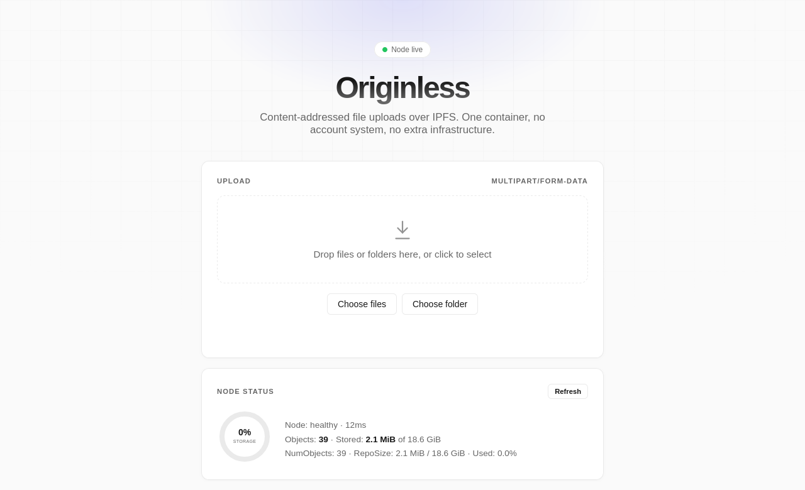

# Originless

**Self-hosted file hosting where the address never dies.**

Upload a file at home. Fetch it from anywhere by its CID. No domain, no DNS, no reverse proxy, no cloud bill — just one container and the files you already own.

[](https://github.com/besoeasy/originless/pkgs/container/originless)
[](https://go.dev/)
[](https://ipfs.tech/)
[](LICENSE)
[](https://github.com/besoeasy/originless/stargazers)

[](https://originless.space/)

> **The short version:** keep your originals on your computer. If a file disappears from the node, upload it again — the CID comes back identical. Permanence is a habit, not a subscription.

## Why links die

Every link is a promise that someone keeps paying for the server behind it. Domains expire. Buckets get deleted. Object-storage bills grow. Platforms remove posts. Folders move. The result is link rot — the slow disappearance of the internet's memory.

Originless flips the model.

A file's address is its **CID**, a cryptographic hash of the bytes. The address is derived from the content, not from a server, domain, or account. If you have the bytes, you can serve the file at the same address from anywhere. No DNS to update. No origin to trust. No one can rename the file out from under you.

## How it works

1. **Run one container.** Kubo, the HTTP API, and a dashboard ship together.
2. **Upload a file or folder.** You get back a CID.
3. **Fetch it by CID.** Through your node's `/ipfs/<cid>` route, or any IPFS-capable client that can reach a node holding the bytes.

No account. No API key. No database. No reverse proxy.

## Quick start

```bash
docker run -d --name originless \
  -p 3232:3232 \
  -e STORAGE_MAX=20GB \
  ghcr.io/besoeasy/originless:latest
```

Open the dashboard at [http://localhost:3232](http://localhost:3232). Check readiness:

```bash
curl -fsS http://localhost:3232/healthz
```

`/healthz` returns `503` when the embedded Kubo node is unreachable.

## The part everyone gets wrong

**IPFS does not store your files for free. Originless does not either.**

The container's repository is temporary. Unpinned content is eligible for garbage collection, and removing the container removes the repository with it.

But the CID never changes. Uploading the exact same file again produces the exact same CID, because the CID is the hash of the content. That means:

- **Keep your originals.** Your computer is the master copy, not the container.
- **Re-upload when a CID stops resolving.** The link starts working again at the same address.
- **Pin what must survive GC** while the container is running.
- **Keep filenames and folder structure** for folder uploads — changing either changes the folder's CID.

> **The node is the delivery layer. You are the permanent layer.**

Garbage collection is not a bug. It keeps the node lean and self-cleaning: pin what matters or re-upload it when needed, and everything else ages out. Storage follows attention instead of growing forever — and unlike an object-storage bucket, it does not bill you for every forgotten file.

### Keepalive script

Record the CID and local path when you upload:

```bash
cid=$(curl -fsS -F "file=@hello.txt" http://localhost:3232/up \
  | sed -n 's/.*"cid":"\([^"]*\)".*/\1/p')
printf '%s\t%s\n' "$cid" "$PWD/hello.txt" >> manifest.tsv
```

Then re-upload only what disappeared:

```bash
#!/usr/bin/env bash
# originless-keepalive.sh <manifest.tsv>
# manifest lines: <cid>\t/path/to/local/file
set -euo pipefail

NODE="${ORIGINLESS_URL:-http://localhost:3232}"

while IFS=$'\t' read -r cid file; do
  if curl -fsSL -o /dev/null "$NODE/ipfs/$cid"; then
    continue
  fi
  if [ ! -f "$file" ]; then
    echo "missing local copy: $file" >&2
    continue
  fi
  curl -fsS -F "file=@$file" "$NODE/up" >/dev/null
  echo "restored $cid from $file"
done < "${1:?usage: $0 manifest.tsv}"
```

Run it from cron, a systemd timer, or inside your own app. No manifest? Re-upload the whole folder — identical bytes are deduplicated, so repeat uploads are cheap:

```bash
find "$HOME/originless-files" -type f -print0 |
  xargs -0 -n1 -P4 -I{} curl -fsS -F "file=@{}" http://localhost:3232/up >/dev/null
```

For folders, send the same relative paths to `/upf` so the root CID stays identical.

## Use cases

Originless is not another cloud drive. It is a tiny, programmable file backend with addresses that outlive servers.

| Use case | Why it fits |
| --- | --- |
| **Nostr** | Attach images, video, and files to notes. Paste a CID or your gateway URL — no blob-host account, no API key. |
| **Forums (bb, Discourse, custom boards)** | Host avatars, screenshots, and attachments outside the forum database. Old threads keep working when the board moves. |
| **Reddit posts** | Share images, clips, and PDFs from your own node instead of a third-party host that may rate-limit or disappear. |
| **Custom apps** | Add a `/up` endpoint for user uploads, attachments, build artifacts, and generated reports. |
| **AI agents and LLM workflows** | Give agents stable URLs for context files, datasets, screenshots, and outputs. Hashes let them verify what they fetched. |
| **Personal sites and blogs** | Serve images, audio, and video with Range and ETag support — no object-storage bill. |
| **Community archives** | Many people can hold and re-upload the same files. The CID is the shared address. |
| **Software releases** | Publish binaries addressed by hash so users can verify the download. |

## What you get

- **One container.** Kubo, the HTTP API, and a dashboard with no external services.
- **No domain or DNS.** The CID is the address.
- **No accounts or API keys.** Upload with plain HTTP.
- **Folders.** Upload a directory and browse it by CID.
- **Streaming-friendly.** `Range`, `ETag`, conditional requests, and `HEAD`.
- **Local-only by default.** Your node is not an open public gateway.
- **Small API surface.** `POST /up`, `POST /upf`, `GET /ipfs/...`, `GET /healthz`, `GET /stats`.
- **Content-addressed.** Same bytes, same CID, every time.
- **Up to 1 GB per upload.**
- **No lock-in.** The API is plain HTTP, and CIDs work with any IPFS client or gateway.
- **Runs anywhere.** A homelab box, a Raspberry Pi, or a small VPS.

## Upload and fetch

```bash
# upload — returns JSON with the CID
curl -F "file=@hello.txt" http://localhost:3232/up

# fetch it back through this node's gateway
curl -fL "http://localhost:3232/ipfs/<cid>?filename=hello.txt" -o hello.txt
```

Open `http://localhost:3232/ipfs/<cid>` in a browser to view the content. The gateway supports `Range` requests and `ETag`s, so audio/video seeking and conditional downloads work.

The same CID works with any IPFS-capable client or gateway that can reach a node holding the bytes:

- Browser: [inbrowser.link/ipfs/](https://inbrowser.link/ipfs/)
- Apps: [Helia Verified Fetch](https://github.com/ipfs/helia-verified-fetch)
- Gateways: [Rainbow](https://github.com/ipfs/rainbow) or any `https://<gateway>/ipfs/<cid>`

The quick start publishes your node's HTTP port. The swarm listener stays internal by default, so a public gateway can only fetch the file if you publish the swarm port or another node holds a copy.

### Folders

Upload a folder with `/upf`:

```bash
curl \
  -F "file=@folder/one.txt;filename=folder/one.txt" \
  -F "file=@folder/nested/two.txt;filename=folder/nested/two.txt" \
  http://localhost:3232/upf
```

Folder uploads are wrapped in a root directory. Browse the returned CID with a trailing slash, then fetch files under it:

```text
http://localhost:3232/ipfs/<cid>/
http://localhost:3232/ipfs/<cid>/folder/nested/two.txt
```

## Configuration

| Variable | Default | Description |
| --- | --- | --- |
| `STORAGE_MAX` | `20GB` | Soft limit for the IPFS repository. |
| `PORT` | `3232` | HTTP port inside the container. |
| `IPFS_GATEWAY_FETCH` | `false` | Sets Kubo's `Gateway.NoFetch`. When `false`, `/ipfs/` serves only CIDs stored locally. Set `true` to allow network fetches. |

Uploads are capped at 1 GB per request. The repository is temporary — keep your originals and re-upload when needed.

## Routes

| Method | Route | Purpose |
| --- | --- | --- |
| `GET` | `/` | Dashboard |
| `GET` | `/healthz` | Container and IPFS health |
| `GET` | `/stats` | IPFS repository metrics |
| `POST` | `/up` | Upload a file or folder |
| `POST` | `/upf` | Explicit folder upload |
| `GET`, `HEAD` | `/ipfs/{cid}[/path]` | File or directory via the local Kubo gateway |

### `/ipfs/` gateway

`/ipfs/` proxies to Kubo's gateway on the fixed loopback address `127.0.0.1:8080`, so the only public port remains Originless itself. Directory indexes, `index.html` resolution, `Range`, `ETag`, conditional requests and `?filename=` are handled by Kubo.

The gateway is **local-only by default**. It serves CIDs this node already holds and returns an error for anything else, so the node cannot be used to fetch arbitrary content from the IPFS network. To allow network fetches:

```bash
docker run -d --name originless \
  -p 3232:3232 \
  -e IPFS_GATEWAY_FETCH=true \
  ghcr.io/besoeasy/originless:latest
```

When enabled, anyone who can reach port `3232` can use the node to retrieve arbitrary IPFS content.

## Security

Originless has no accounts and no authorization. Anyone who can reach port `3232` can upload and download content held by the node. CORS is open to any origin by design, so browser apps can call it directly.

The `/ipfs/` gateway serves locally stored content by default. If you enable `IPFS_GATEWAY_FETCH=true`, the node will also retrieve arbitrary CIDs from the IPFS network on request.

Expose the port only where you intend to use it. If you need private access, place Originless behind a VPN, Tailscale, or a reverse proxy with authentication. Kubo's API and gateway stay on loopback inside the container, and only `3232` is published. The swarm listener is internal to the container network unless you publish it.

## FAQ

### Is my file permanent?

The address is. The bytes need a home. Keep a copy on your computer and re-upload when the CID stops resolving; it comes back at the same CID. If it must survive garbage collection while the node is running, pin it.

### What happens when garbage collection runs?

Unpinned content may be removed. That is intentional: the node stays lean and you decide what to keep by pinning or re-uploading. Pinned content is protected.

### Isn't IPFS already permanent?

IPFS is a network and an addressing scheme, not a free backup. Someone has to store and serve the blocks. Originless is that someone for your files.

### Do I need a domain or a public gateway?

No. `/ipfs/` is local-only by default. Enable `IPFS_GATEWAY_FETCH=true` only if you want the node to retrieve arbitrary CIDs from the network.

### Do I still need a public address?

Yes. The CID replaces the domain and origin, not the network. People need a route to a node that holds the bytes — your published HTTP port, a tunnel, a VPN, or another IPFS node with a copy.

### Does re-uploading duplicate data?

No. Identical content produces identical blocks, and Kubo deduplicates them.

### Can I move to another server and keep the links?

Yes. A CID is independent of hostnames. Upload the same bytes to any Originless node — or enable gateway fetch — and the address still works.

### Is there an upload limit?

1 GB per upload request. `STORAGE_MAX` controls the soft repository limit.

## Development

Requires Go 1.24+ (and `kubo` for the full single-binary setup).

```bash
go vet ./... && go build ./... && go test -race ./...
```

Build the image locally: `docker build -t originless:dev .`

## License

MIT © [Aman Singh Katal](https://github.com/besoeasy). See [LICENSE](LICENSE).

## Star the project

If Originless saves you a cloud bill or a broken link, give it a star and share it with someone who self-hosts. Every node that keeps a copy makes the network a little more permanent.

- Website: [originless.space](https://originless.space/)
- GitHub: [besoeasy/originless](https://github.com/besoeasy/originless)
- Container: [`ghcr.io/besoeasy/originless`](https://github.com/besoeasy/originless/pkgs/container/originless)
